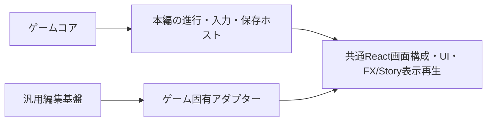

# 現行実装構造

## 入口と依存方向

現行公開デモはビルド不要のclassic JavaScriptで、`index.html`が起動する。純粋コアはCommonJSでも読める。別の`apps/game-web/`にReact＋TypeScript＋Viteの技術検証アプリがPR #11でmain反映済み。API・DB・認証・React本番切替は未導入。
`UI/アプリ → 戦闘エンジン → 効果・数値・データ` の方向。`src/game/`からDOM、Audio、タイマー、共有appを参照しない。

| ディレクトリ・ファイル | 責務 |
|---|---|
| [index.html](../index.html) | script/CSS読み込み・画面入口 |
| [src/game/card-data.js](../src/game/card-data.js) | 現行19種・初期3セット・固定5ボス |
| [card-effects.js](../src/game/card-effects.js) | 状態とスキルから効果を構築 |
| [combat-math.js](../src/game/combat-math.js) | HP・バリア・毒・回復等の計算 |
| [battle-engine.js](../src/game/battle-engine.js) | 合法手・更新・ターン開始終了・勝敗・JSON境界 |
| [boss-planner.js](../src/game/boss-planner.js) | AI-2の列挙・候補選別・先読み |
| [progression.js](../src/game/progression.js) | 習得候補・追加・交換、イベント定数 |
| [src/app-state.js](../src/app-state.js) | ブラウザ側状態 |
| [src/app/](../src/app/) | 戦闘／習得制御、タスク世代、演出時間 |
| [src/ui/](../src/ui/) | DOM更新、操作、詳細、結果、FX、ログ |
| [src/styles.css](../src/styles.css)、[castle-ui.css](../src/castle-ui.css)、[readability.css](../src/readability.css)、[battle-layout.css](../src/battle-layout.css) | 基本配置→城内UI→可読性→戦闘寸法の最終レイヤー |
| [assets/](../assets/) | 素材マップとAudioエンジン、同梱素材 |
| [tests/](../tests/)、[scripts/](../scripts/) | 自動・ブラウザ・静的検査、計測 |
| research/two-boss/（`research/two-boss`、GitHub未収録） | 独立した世代ボス比較。公開本編に読み込ませない |
| [reports/](../reports/) | 条件・生データ・代表ログ・結果。過去結果を上書きしない |
| [src/game/legacy/](../src/game/legacy/)、[archive/v0.9.5/](../archive/v0.9.5/) | 旧三世代ルールと旧画面の隔離。現行導線に戻さない |

## 共通API・状態

```javascript
const Battle = require('./src/game/battle-engine.js');
const state = Battle.createState({playerDeck: ['slash','barrier'], bossPresetId:'boss_knight_defense'});
const result = Battle.transition(state, {type:'card',side:'player',id:'slash'});
// result: {state, ok, reason?, events}; 入力stateは不変
```

`execute`は可変更新、`transition`はコピーを更新。`availability`/`accelerationStatus`がUI・AI共通の使用可否を返す。
状態はschemaVersion 2 / ruleset first-era-trial。行動者・先攻・ラウンド・勝敗、各actorのdeck、hp/maxHP、mana/manaCap、ownTurn、used、readyOn、加速予約、barrier、poison、weak、manaPenalty、攻撃強化・布石を保持する。
`snapshot`/`restore`は参照共有を避け、異なる旧形式を無条件に復元しない。`readyOn`は所有者の自ターン番号。
イベントは実際に成立した操作を表し、コントローラーが視覚・音声を追従させる。リセット・再戦・勝敗でタスクを解除し古い継続処理を世代判定で無効化する。

## 研究との分離

2ボス研究は独立エンジン・planner・ページ・設定で仮数値を扱う。新2スキルはさらにdefense-skills配下に分離。
本編19種の定義は変更しない。研究の6枚・初手MP3を本編上限へ逆流させない。
旧研究two-boss-research-v2と新スキルtwo-boss-defense-skills-v1の保存形式を混同しない。JSONに書けることは新版セーブ機能の実装を意味しない。
FX Labは別PR。現在mainの入口・コードへマージされているとは扱わない。

## 起動・検査

```bash
python -m http.server 8000 --bind 127.0.0.1
# http://localhost:8000/
npm test
npm run check
npm run test:browser
npm run simulate -- 10
```

ゲームはfile://でも起動可能。Nodeは検査用。ブラウザスモークにはChromeが必要で`CHROME_PATH`指定可、成果は`.test-artifacts/`へ。シミュレーションは3初期セット×5ボス×シード、双方AI、40R観測打切り。人間の勝率ではない。
STEP 0は資料更新のみ。必要な静的・軽量テストに限定し、シミュレーション・ブラウザ演出・実機音声の再検証は行わない。
`package.json`の0.9.5は旧管理値で、現行に旧ルールが復活した意味ではない。

## GitHub Pages

静的なリポジトリルートを公開する運用。公開URL： https://elizabeeeth555.github.io/roguelike-card-game/ 。originはelizabeeeth555/roguelike-card-game。
2026-11-11、GitHub APIで公開方式`legacy`、公開元`main`／`/`を確認。今回、設定・配信ファイルは変更しない。Reactのビルド出力を公開ルートへ置かない。
公開作業ではGitHub側設定、対象コミット、リモート差分を別途確認し、明示指示なしにpush/deployしない。

2026-11-10公開設定確認：GitHub Pagesはlegacy方式、mainブランチのルート（/）から自動公開。今回もこの設定を維持する。

## UI設定の最小適用経路（STEP 2-B②）

`presentation-config.js` → `presentation-adapter.js` → documentElementの既知CSS変数 → `battle-layout.css`。index.htmlでclassic scriptとして読み、main.jsが既定設定を初期適用する。本編のビルド、fetch、React依存は追加しない。

- [設定](../src/ui/presentation-config.js)：`GamePresentationConfig.normalize({desktop:{enemySkillHeightPx},mobile:{enemySkillHeightPx}})`。入力を変更せず、既知の自己データプロパティだけを読み、新しい凍結済み設定を返す。不正値・欠落値はプロファイル別の既定値へ戻す。
- [アダプター](../src/ui/presentation-adapter.js)：`GamePresentationAdapter.apply(normalized, style)`。同設定モジュールが正規化したオブジェクトのみを受け取り、`--ui-enemy-skill-height-desktop`／`--ui-enemy-skill-height-mobile`の2項目だけを反映する。テストではstyleを注入する。JSONを使う将来の入口でも、先にnormalizeを通す必要がある。
- CommonJSでも公開し、Nodeで同じ検証処理を試験できる。モジュール未読込時は起動側が適用を省略し、CSSの70px／77pxフォールバックが残る。
- 設定スキーマ全体・JSON読込UI・王座工房は未実装。操作可否・戦闘状態・素材・演出時間はこの経路に含めない。

## React移行とSteam将来対応の設計方針（2026-11-10承認）

2026-11-11の最新承認で進め方を更新。**React＋TypeScript＋Viteの段階移行方針は確定**。STEP 3-AはPR #11でmain反映済みだが、公開デモはclassic版のまま。新しい拠点・10種類から5つの自由編成・老王戦を実装対象とし、旧ランダム習得型の導線を無条件に移植しない。

- **ゲームコア**：状態・合法判定・効果・イベントを所有する。DOM、React、保存先、音声、Steam APIを混ぜない。既存の戦闘・AI・スキル定義は可能な限り再利用するが、未実装の奥義を動くものと扱わない。
- **本編アプリ制御**：編成確定、戦闘操作、勝敗、進行と保存契機を管理する。旧版とReactの二重DOM所有・二重実行を避け、演出キャンセルをホスト側で管理する。
- **共有表示**：同じReact部品だけでなく、画面構成・将来のFX／Story描画・再生処理まで本編と工房で同じソースを使う。次節の境界を必須とする。
- **保存ホスト**：ローカル自動保存の読み書きをコアから分離する。編成確定・初回勝利固定記録・詳細ログと、戦闘中一時状態を区別する。承認方針は[進行](features/progression.md)、詳細スキーマは未決定。現行snapshot/restoreや品質設定のlocalStorage保存は新進行セーブの実装ではない。

WebではlocalStorageを想定し、PC配布版では保存・入力・音声等のホスト境界を差し替えられる設計にする。**Steam正式発売・Electron／Tauri等のパッケージ方式は保留／未決定**。Steamworks、実績、クラウド保存等は未実装で、第一紀初期には導入しない。

本編と工房を並行して整備し、工房完成と本編バランス確定を相互の着手条件にしない。旧「Reactの全画面移行→FX等→本番切替→工房」の順序は必須手順ではなくなった。早期に共通表示→工房MVP→FX/SE→Story→適用・互換性改善を進める第一候補は[最新ロードマップ](status.md)を参照。公開切替は新版検証後の別途承認が必要で、現行Pagesを自動上書きしない。

## 本編と王座工房の共有境界（最新承認）

**必須・未実装**：工房に本編を模倣した別プレビュー画面を作らない。共有React表示コンポーネント・同じ画面構成・演出描画処理へ、本編は実ゲーム状態、工房は編集／試写用データを渡す。共有表示のソース変更が双方へ反映される構造にする。手作業で画面やCSSをコピーし、後から同期する方式を共通化の完成としない。



上図は目標構造。工房や共通FX／Storyランタイムの実装済み図ではない。

| 責務 | 所有するもの | 所有しないもの |
|---|---|---|
| 汎用編集機能 | 要素選択、移動・拡縮、プロパティ編集、プレビュー操作、タイムライン、保存・読込の編集機構 | 本作のスキル・王・勝敗・素材IDの意味 |
| ゲーム固有アダプター | 設定スキーマ、素材ID、ゲームデータ、共通画面への接続、編集データと公開用設定の変換 | 汎用編集機能の複製、ゲームルールの独自実装 |
| ゲーム本編 | 実際の状態による描画・再生・進行、保存契機とプラットフォーム接続 | 工房専用のドラッグ・選択・編集履歴 |
| 共通描画・再生 | 渡されたデータを同じ部品・画面・FX／Story処理で表示 | 自動セーブ、戦闘実行、工房固有の編集副作用 |

別ゲームの表示部品とアダプターを接続して編集基盤を再利用できることを目標にする。初期段階で大規模な共有パッケージ再編や巨大な汎用フレームワークを作らない。具体的なインターフェース・配置・設定スキーマは未決定。

素材の私的読込と公開設定の書出しを分離し、Viteのpublic/import/copy経路へ非公開素材を入れない。FX・SEはローカル素材で早期に制作・保存・蓄積可能にする。新工房のA/B比較は廃止。既存FX Lab PR #1は保護し、互換性調査や移行は別承認で行う。

## STEP 3-A：独立React本編の技術検証

`apps/game-web/`にReact＋TypeScript＋Viteの実験アプリがPR #11でmain反映済み。現行公開デモは置換せず、React版への本番切替は未実施。ルートindex.html、既存classic UI、戦闘コア・AIは維持する。本編全体の移植ではない。

`React入力・状態 → battle-adapter.ts → 既存GameBattle / GamePlanner`。SkillCard・HealthBarはpropsベースの表示専用部品であり、工房との共有パッケージ化は未実施。保存・音声・OS入力などはホスト側の責務とし、コアへ持ち込まない。

Viteアダプターが公開コア5ファイルだけを依存順のclassic scriptとして配信／同梱する。コピー先はアプリ内dist/engineで、元ソースは変更しない。publicDir無効、devのファイル許可範囲も分離。React版distはGit除外・Pagesルートへの出力なし。起動・固定依存・検証手順は[アプリREADME](../apps/game-web/README.md)。

STEP 3-B①のより本編に近い戦闘画面・入力管理は元worktreeの別作業に存在し、mainには未反映。本資料更新へソース差分を取り込まない。既存部品を新プロトタイプと工房の共有表示へつなぐ際は、進行・編集操作と描画の境界を改めて確認する。

## 新第一紀の明示選択API（2026-11-13）

[first-era-rules.js](../src/game/first-era-rules.js)は採用カタログ・編成検証・効果命令・固有能力フックのみを所有する。既存battle-engineの実行/ターン/MP/CD/バリア/勝敗処理を共有し、別の研究エンジンを本編へ複製しない。boss-plannerのAI-2を共有し、新版の毒の残存価値計算だけを現在の毒tickに合わせる。研究plannerや探索パラメータを採用しない。

```javascript
const Battle = require('./src/game/battle-engine.js');
const Rules = require('./src/game/first-era-rules.js');
const state = Battle.createState({ruleset: Rules.RULESET,
  playerDeck: ['slash','heavy_slash','barrier','first_era_corrosion','first_era_venom_blade']});
const allowed = Battle.availability(state, 'player', 'heavy_slash');
const next = Battle.transition(state, {type:'card',side:'player',id:'heavy_slash'});
const echoAllowed = Battle.ultimateStatus(next.state, 'player');
const result = Battle.transition(next.state, {type:'ultimate',side:'player'});
// result: {state,ok,reason?,events}; executeは可変、transitionは元状態を保持
```

`Rules.pool`/`validateDeck`が編成の正、`Battle.getCard(state,id)`がプロファイルに対応する定義、`legalActions`が奥義を含む合法手一覧を返す。`poisonTickDamage(state,n)`は共通毒計算をAIと共有する。失敗時は状態を変更せずok:false。イベント配列は各操作の戻り値から取得し、コアにUI・保存・音声を混入させない。

新版はschemaVersion3 / ruleset first-era-v1、bossPresetId ashen_king、`bossState`と`ultimate`で固有状態を保持。旧schema2/first-era-trialの既定生成・snapshot復元を維持する。新旧を自動変換しない。キャラクター素材IDは新版ではnull（今回素材・表示は未接続）。状態生成時に5つの採用IDを必ず渡す。

CommonJSは新モジュールを自動解決。ブラウザで将来新版を使う場合はData/Effectsの後、battle-engineの前にfirst-era-rulesを読み込む。既存classic/Reactの入口は変更せず、旧ルールはこの追加scriptなしで動作する。PR #25時点ではReactへのアダプター/型/画面接続、セーブは第2弾以降としていた。追加実装は下記ホスト節を参照。

## 第一紀プレイ可能版のホスト（2026-11-13）

`apps/game-web/first-era.html`を追加入口とし、既定indexと開発専用dev-previewを維持する。Viteは許可済みengineと原本4点だけを明示配信/ビルドし、リポジトリ全体やprivate-assetsを公開しない。Pagesのルート/公開設定は変更しない。

- `first-era/FirstEraApp.tsx`：画面進行・編成ドラフト・入力ロック・世代付き非同期演出・再戦を所有する。
- `first-era/presentation.ts`：コアの状態と使用可否・読取専用previewを共通BattleViewModelへ変換する。
- 既存`BattleView`/表示部品：legacy/new layoutの両方を同じ描画ソースで扱う。Core/AI/保存・工房編集を呼び出さない。
- `first-era/save.ts`：版付きゲーム進行の検証・保存先アダプター・初回勝利固定。保存先はentryから注入し、工房保存と分離する。
- `first-era/ui.tsx`：ボタン・パネル・モーダルを共有する。フェードは画面切替だけで、モーダルは対象外。

詳細な画面仕様は[UI](features/ui.md)、保存内容/契機は[進行](features/progression.md#playable-save-flow)。ゲームコア・ID・snapshot仕様・研究データはこの段階で変更しない。
