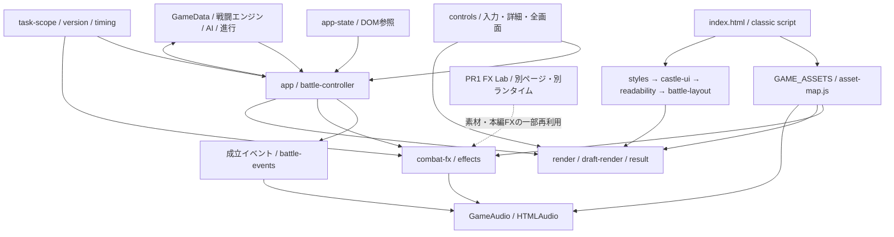

# UI・演出設定共通化の設計調査（STEP 2-B①）

調査日：2026-11-10（日本時間）。本書は設計提案であり、スキーマ・分離対象・リファクタリングの正式採用や実装を意味しない。

## 1. 結論と調査基準

王座工房と本編は、**設定データを共有し、画面制御は別々に持つ**方式を推奨する。本編をReactへ移行せず、工房の編集用JSONから公開可能な設定だけを取り出し、本編のclassic script用設定へ変換する。CSSカスタムプロパティは、その設定を表示へ適用する手段として併用する。

最初の実装は、最終CSSが所有する敵スキル欄の高さなど、影響範囲が狭い値の分離に限定する。立ち絵倍率、上下UIの配置、演出時間の全面分離を一度に行わない。これらは複数の値や操作待ち時間と結び付いている。

### 確認したGit・公開状態

| 項目 | 調査結果 |
|---|---|
| 最新リモートmain | `e6daad01856ea18886eae94ccb2b6898aa65840e` |
| STEP 2-A PR #6 | マージ済み。上記mainはそのマージコミット |
| 調査ブランチ | `research/ui-config-foundation-audit`。最新origin/mainから作成 |
| 作業開始時のブランチ | `chore/private-asset-protection`、HEAD `1364c3f874b7b12758d992677b29f16f8ac8563d` |
| 既存未追跡ファイル | 3,337件。研究・報告等を保持し、ステージング・移動・削除しない |
| FX Lab PR #1 | OPEN、`ui/castle-six-characters`。読み取り専用で調査 |
| PR #1調査時HEAD | `c63a4990244ff09c686c0e268b15910d8f9aa32e` |
| GitHub Pages | `legacy`、公開元 `main` の `/`。設定変更なし |
| 今回の変更 | 本レポートのみ。コミット・push・PR作成・マージ・公開は行わない |

現在のdocs/status.mdにはSTEP 2-Aの作業時点の記述が残るが、今回の基準はGitHub APIとリモートmainで確認したPR #6マージ後とした。許可範囲がレポートのみのため、既存資料は更新していない。

[AGENTS](../../AGENTS.md)、[資料入口](../../docs/README.md)、[開発運用](../../docs/development-workflow.md)、[状態](../../docs/status.md)、[構造](../../docs/architecture.md)、[UI](../../docs/features/ui.md)、[世界観・素材](../../docs/features/world-assets.md)と実コードを照合した。王座工房はUI・FX・Storyの統合ツール、A/B比較廃止、React＋TypeScript＋Viteは工房のみ、バランス調整延期という最新承認方針を前提とする。工房自体は未実装。

## 2. 現在の依存関係



戦闘コアはDOM・音声・表示タイマーから分離されている。一方、表示側はclassic scriptの共有状態、DOM ID、グローバル関数へ依存する。工房から本編UI一式をそのままReactへ移植する案は第一候補にしない。データ、純粋な検証・変換処理、各ホスト向けアダプターを分ける。

主な参照： [HTML](../../index.html)、[app-state](../../src/app-state.js)、[描画](../../src/ui/render.js)、[入力](../../src/ui/controls.js)、[戦闘制御](../../src/app/battle-controller.js)。

## 3. CSSと表示値の所有者

### 読み込みと上書き

index.htmlの順序は次のとおり。後のファイルでも、詳細度やinline styleが強い宣言を必ず上書きできるわけではない。

| 順序・ファイル | 主な責務 | 共通化時の注意 |
|---|---|---|
| 1 [styles.css](../../src/styles.css) | 基本文字・色、構造、スキル状態、旧来のレイアウトとレスポンシブ規則 | 基本トークンだけでは全配色を変更できない |
| 2 [castle-ui.css](../../src/castle-ui.css) | 城内テーマ、背景、立ち絵、HUD、選択詳細、FX、揺れ・数値演出 | 座標・重なり・疑似要素のはみ出しが密結合 |
| 3 [readability.css](../../src/readability.css) | 文字・詳細領域・宣言演出・可読性 | 一部は寸法も所有。単なる文字設定ではない |
| 4 [battle-layout.css](../../src/battle-layout.css) | 戦闘UI第1弾の最終配置、コンパクト表示、ツールチップ、個別画像補正 | 最初の分離候補。先行CSSとの競合確認が必要 |

具体例：readability.cssの`.enemy-deck .inline-card-details`は、後続battle-layout.cssの`.inline-card-details`より詳細度が高い。モバイル詳細の最大高さを「最後にある210pxが常に適用」と解釈してはいけない。今回の指摘は静的なカスケード分析で、ブラウザのcomputed style測定は未実施。

### 定義場所・既定値・責務

| 対象 | 現在の値・定義場所 | 分離判断 |
|---|---|---|
| 基本文字色 | styles.cssの`--text:#eee9de`、`--muted:#b6b9c3`等 | 既存トークンから段階的に可能。ただし個別色は残る |
| 基本文字 | styles.cssの14px/1.5に対しreadability.cssが16px/1.6等を上書き | 全体一括変更は折返し・高さへ波及 |
| 敵スキル高さ | battle-layout.cssのPC70px、モバイル77px | 小さな分離の第一候補。heightとmin-heightを一組にする |
| PC下部 | 手札148px、HUD最小148px、右操作列130px、HUD幅216px、手札左230px | 個別ではなくレイアウト一式として後段で扱う |
| スマホ下部 | 手札216px、行132px＋76px＋隙間8px、HUD下228px | 一つだけ変更すると重なりやすい |
| 立ち絵領域 | PC上216/下154px、スマホ上258/下258px | 画像の倍率だけでは表示領域が決まらない |
| 詳細ツールチップ | battle-layout.cssの幅最大330px、余白8px相当。controls.jsが実寸で位置補正 | 幅・余白は設定候補、補正計算は実行コード |
| HPバー・ダメージ予測 | render.jsが状態からwidth/left等を設定 | HP・MP・合法手から導出する値。編集設定へ出さない |
| スキル状態 | render.jsの使用済・CD・MP不足、controls.jsの操作可否 | ゲーム状態との接続を維持。デザイン設定で合法性を変えない |
| 背景 | effects.jsが素材パスから`--scene-art`をinline指定 | 相対URLの基準を維持する |
| 立ち絵 | asset-map.jsのframingをeffects.jsが`--boss-*`へinline指定 | root変数を追加するだけでは上書きできない |
| 画像補正 | battle-layout.cssの画像ファイル名セレクター | 素材IDとの明示的な対応へ移すなら別工程で検証 |
| アイコン | HTML/JSの文字・疑似要素・CSS | 任意HTMLやCSSをJSONから挿入する設計にはしない |

### レスポンシブ条件

基本境界はPC `min-width:761px`、スマホ `max-width:760px`。加えて761〜1000px、低いPC画面（高さ740px以下）、狭いスマホ（350px以下）、`prefers-reduced-motion`などがある。入力側は`(hover:hover)`とタッチ判定を併用する。

CSSカスタムプロパティを通常の`@media`条件へそのまま代入することはできない。最初は既存のメディアクエリーを残し、その内側の値だけを分離する。工房の画面サイズとゲームの表示プロファイルも区別する。

### 重なりとDOM直接操作

castle-ui.cssにはapp-shellの`isolation:isolate`、立ち絵のtransform、FXレイヤーz-index 9、HUD・手札・詳細・ログ・メニューなど複数の重なりの文脈がある。内側のFXにz-index 24があっても親レイヤー9を越えてHUDの前面へ出るとは限らない。

controls.jsは詳細枠・使用ボタンの寸法と画面端を測って移動量を補正し、ホバー／フォーカス情報と実行可能性を分離する。render.jsの再描画はDOMを置き換える。これらの計算やイベント接続は設定値ではない。Reactと本編が同一DOMを同時に所有しない設計が必要。

## 4. 素材・立ち絵・将来のレイヤー

[asset-map.js](../../assets/asset-map.js)は背景、キャラクター画像、BGM、SEの中心的な登録場所。ただし全参照が集約済みではなく、castle-ui.cssにも粒子画像の相対パスが直接ある。

- 背景：`assets/backgrounds/castle_corridor.webp`と`assets/backgrounds/castle_throne_room.webp`。
- 現行キャラクターはcharacterSetsのface/bust/boss PNGを使用。旧SVG参照も別に残る。
- 本編BGMはOGG/MP3の代替パスと音量補正を持つ。5ボス分の切替枠はあるが、追加4曲は未収録で既存曲へフォールバックする。
- SEは`fx_hit_light`等の公開IDと従来ID。ファイルパスを工房の任意入力にせず、公開素材レジストリーを介して参照する案が安全。

### キャラクター固有補正

| characterSets ID | 元のscale | 最終CSSの補正係数 |
|---|---:|---:|
| `01_black_swordsman` | 1.78 | .83 |
| `02_heavy_knight` | 1.72 | .85 |
| `03_witch` | 1.72 | .82 |
| `04_giant_warrior` | 1.64 | .88 |
| `05_scout` | 1.80 | .86 |
| `06_sage` | 1.75 | .84 |

モバイルscaleは1.35。現在のx/yとmobile-x/yは0px。PC画像高さは`(100svh - 260px) × scale × 補正係数`、モバイルは`(100svh - 465px) × mobile-scale × .88`。したがって表の係数を一つの「倍率」に置換すると、ビューポート依存やクリップ領域を失う危険がある。IDと画像名が完全一致しないものもあり、ファイル名の一括変更は不要。

### 将来レイヤー案（未実装）

| 順序 | レイヤー | 現在の素材対応 | 将来の独立設定 |
|---|---|---|---|
| 1 | 背景 | 既存の合成背景を利用可能 | fit、基準枠、位置 |
| 2 | 王座＋石段 | 独立素材の登録は確認できない | 同一形状の基準、pivot、位置・倍率 |
| 3 | キャラクター | 現行6キャラクターの画像あり | 個別倍率、接地位置、表示順 |
| 4 | 前景・遮蔽 | 独立素材の登録は確認できない | マスク・前後関係 |
| 5 | 影・光・FX | CSS等の演出は存在 | 対象アンカー、加算的な装飾 |

assetsの登録とファイル名検索では、老王用の独立した王座・階段・旗・前景の素材対応を特定できなかった。全画像を意味的に鑑賞・同定した結果ではない。チャットで採用された老王の王座素材との対応は未確認。

既存背景に焼き込まれた王座を設定だけで人物から分離することはできない。独立素材が揃うまでは合成背景をそのまま使い、未配置レイヤーは無効／assetIdなしとする。架空のファイルパスを作らない。王座と石段の基準形維持は承認方針、具体的な素材・pivot・座標は今後の確認対象。

画面UIはCSSピクセルとメディアクエリー、シーンは将来の基準座標＋表示変換、FXは対象アンカーからのオフセットとして分ける案を推奨する。基準解像度は未決定。背景coverの切抜き、透明画像の余白、人物の足元、画面内のUI余白を含めて設計する必要がある。シーン内の重なり順とHUDの重なり順を同一の数値体系に混ぜない。

## 5. 演出イベントと時間管理

参照：[combat-fx](../../src/ui/combat-fx.js)、[battle-events](../../src/ui/battle-events.js)、[effects](../../src/ui/effects.js)、[presentation-timing](../../src/app/presentation-timing.js)、[task-scope](../../src/app/task-scope.js)、[audio-engine](../../assets/audio-engine.js)。

### 実行経路

1. battle-controllerのperformがGameBattle.executeを実行し、戦闘状態を確定する。
2. 成立イベントをログ・HP数値などへ渡す。表示用HPダメージは直前HPとの整合を取る。
3. combat-fxが実HPダメージ、バリア吸収・破壊、回復、毒、補助、消耗などを区別してVFX/SEへ振り分ける。
4. renderで状態表示を更新し、操作待ち時間・敵の次の行動間隔を別に管理する。

工房で変更できるのは表示側。効果量・HP更新順・成立イベントの意味・合法手は設定に含めない。

### 現在の時間・表示値

| 定義 | 通常 | 高速 | 注意 |
|---|---:|---:|---|
| ターン等の宣言 | 2000ms | 1000ms | presentation-timing.js |
| 開始後の間 | 180ms | 100ms | 同上 |
| 敵行動前 | 700ms | 350ms | 同上 |
| 敵の行動間隔 | 900ms | 550ms | 同上 |
| 決着後の間 | 700ms | 350ms | 同上 |
| 結果フェード | 400ms | 240ms | 同上 |
| スキル命中の操作待ち | 420/大700ms | 280/大420ms | battle-controller.js。上表と別の定義 |
| 主なFX | 通常480/大760/毒継続300/決着800ms | 一律の別表ではない | combat-fx.js。表示寿命と操作待ちは別 |
| FXノード後始末 | 900ms | 同じ処理系 | 寿命を延ばす場合は連動確認が必要 |
| 粒子・ノード上限 | 標準6粒子・24ノード | 軽量2粒子・10ノード | 高速と軽量は別の軸 |

FX強度は概ねダメージ1〜2、3〜4、5以上の3段階。サイズは通常130/165/200px、毒継続95px、決着300pxなど。攻撃後の毒・追加効果には100msの遅延表示がある。これらは設定候補だが、同時発生・実イベントとの対応を先にテストする。

操作待ちの大ダメージ判定と、実HPダメージによるFX判定は参照するイベント値が完全に同一ではない。設定分離のついでに判定基準を揃えると挙動変更になるため、別の承認事項とする。

### 座標と音声

本編FXの敵側アンカーは敵の表示領域の中央寄り（高さ約36%）、プレイヤー側はHPトラックの中央。ダメージ数値はCSSで別の位置に配置される。工房側の「同じtarget名」が同じ座標を意味するとは限らない。

本編音声はHTMLAudioの遅延読み込み・SEプール・発音間隔・同時発音数制限を持つ。SEの基本音量、FX用の補正、ユーザー音量を分離する。BGMはボス別記述子、OGG/MP3選択、フォールバック、フェードを持つ。音源の設定値を移しても再生ライフサイクルまで単純なJSONになるわけではない。

### 中断・再戦・リセット

TaskScopeのgeneration、app.version、演出ごとのtoken、タイマー解除が協調する。リセット時のcancelPresentationはタスク取消と表示破棄を行う。宣言、音声フェードなどには別管理のタイマーもある。clearCombatFxだけで全非同期処理が取消になると考えてはいけない。

今後の画像デコード・RAF・Web Animations・WebAudioを導入する場合は、セッション単位のdisposeと古い非同期結果の棄却が必要。設定変更のたびに戦闘処理を再実行してはいけない。既存の勝敗・リセット時の安全性を本調査で新たにブラウザ保証したわけではない。

## 6. FX Lab PR #1の互換性

mainへ取り込まず、PRの固定HEADをgit showで調査した。[core.js](https://github.com/elizabeeeth555/roguelike-card-game/blob/c63a4990244ff09c686c0e268b15910d8f9aa32e/dev/fx-lab/core.js)、[lab.js](https://github.com/elizabeeeth555/roguelike-card-game/blob/c63a4990244ff09c686c0e268b15910d8f9aa32e/dev/fx-lab/lab.js)、[README](https://github.com/elizabeeeth555/roguelike-card-game/blob/c63a4990244ff09c686c0e268b15910d8f9aa32e/dev/README.md)を参照。

### 実際の設定形式

- ルートは`schema: "keisei.fx-lab"`、`version: 1`、`name`、`scene.boss`、`patterns.A/B`。
- 各パターンはvisual、sound、playbackを持つ。playbackは速度、size、x/y、透明度、回転・反転、target、音量、audioDelayMs、loop、gapMs、holdMs、行列・フレーム数・FPS。
- impactにヒットストップ、揺れ、フラッシュ、ダメージ数値の見た目・時間・フォント等がある。
- 追加visual layersとsoundLayersはそれぞれ最大3件。追加visualはローカル素材のみ。これらの追加項目もversion 1の正規化処理内に存在する。
- ローカルファイルは名前・サイズ・lastModified等の識別情報のみをJSONへ保存する。実データを埋め込まず、再読み込み後の再選択が必要。
- 現行正規化はA/B形式を前提とし、Bを省略しても既定のBを補う。単にBを削除して単体編集用スキーマになったとは扱えない。

### タイムラインと差異

| 項目 | FX Labの実装 | 移植時の扱い |
|---|---|---|
| 時間形式 | 一般的なイベント列ではなく、個別delay・durationとデコード後の長さからmixTimelineを計算 | 新形式へ変換する際に意味を明示 |
| 負のSE遅延 | 全体開始をずらし、SE先行を実現 | ゲームの確定前に音を鳴らす設計とは分ける |
| 速度 | 映像フレームに適用。音声pitch/速度とは別 | 全時間・音声を一律に割らない |
| APNG/WebP | ImageDecoder可用時はフレーム制御。native fallbackでは速度等の制約を表示 | ブラウザ差を仕様として残す |
| SE | WebAudio、ユーザー操作でresume | 本編HTMLAudioへそのまま移せない |
| builtin SE ID | `hit_heavy`等。本編は`fx_hit_heavy`等 | 明示的なID変換表を設ける |
| target | boss/playerのみ | 戦旗など未実装対象を勝手に補わない |
| プレイヤー座標 | HUDより上を基準とするLab固有アンカー | 本編HP中央基準との変換が必要 |
| builtin再生 | window.app、$、battleTasks等のホスト用置換を介して本編FXを利用 | 本編／Reactと同じグローバル環境へ無加工で載せない |
| プレビューUI | 独立した模擬戦闘CSS・固定状態。拡大はCSS表示 | 本編全画面API・実戦闘表示の一致を保証しない |
| impact.damageText | 任意の試写用文字 | 実ダメージを上書きする入力にしない |

負遅延の実例：映像1000ms、SE200msを-100ms、別SE300msを+150msに設定すると、映像開始100ms、SE開始0/250ms、全体1100msとなる。

停止時はgeneration、タイマー、RAF、音声source、レイヤー、ObjectURL等を破棄する構造。素材の非同期読込にもtokenがある。将来の工房でも維持する価値があるが、Labのページ全体を共有ランタイムにしない。

### 推奨する移行

旧JSONは読み取り専用のインポートアダプターで扱い、ユーザーがAまたはBを選んで**単一の編集対象**へ変換する。A/B比較UIは新設しない。旧保存データは上書きしない。未対応項目・素材未選択は通知し、黙って消さない。未知versionは拒否または安全な既定表示に戻す。

既存IDは保持し、schemaの名前空間を分ける。ゲーム状態のschemaVersionと表示設定のversionも別物とする。既存JSONを本編へ直接ロードできる互換性は現時点ではない。

## 7. 共通設定の分割案

以下のJSONは**小さな提案例**。実装済みの形式でも、承認済みの最終スキーマでもない。数値は現在値の写しまたは説明用であり、このファイルを本編へ置くだけでは反映されない。

### UI：宣言的な表示値

```json
{
  "schema": "keisei.presentation.ui",
  "schemaVersion": 1,
  "tokens": { "textColor": "#eee9de" },
  "profiles": {
    "desktop": { "enemySkillHeightPx": 70 },
    "mobile": { "enemySkillHeightPx": 77 }
  }
}
```

使用可否、HP、CD残数、ターン、DOMセレクター、イベントハンドラーは含めない。色・フォント・装飾・アイコンは後で既知のキーと素材IDを追加する。画面幅の境界は初期段階では既存CSSが所有する。

### FX：単一レシピ＋対象に対する相対配置

```json
{
  "schema": "keisei.presentation.fx",
  "schemaVersion": 1,
  "id": "slash-heavy-preview",
  "anchor": { "role": "recipient", "space": "target-css-px" },
  "tracks": [
    { "type": "visual", "effectId": "slash", "atMs": 0, "durationMs": 760, "sizePx": 200 },
    { "type": "sound", "assetId": "fx_hit_heavy", "atMs": 0, "gain": 1 }
  ]
}
```

実際の対象・強度は成立イベントが渡す。手動boss/player指定は工房プレビュー設定として分離する。gainはレシピ補正であり、ユーザー音量や本編既存の音量補正を置換しない。操作待ち時間はこのレシピの終了時間と連動させない。実際の本編イベントとの対応表は後工程で作る。

### Story／シーン：素材がない層を実在扱いしない

```json
{
  "schema": "keisei.presentation.scene",
  "schemaVersion": 1,
  "id": "throne-scene-draft",
  "layers": [
    { "id": "background", "order": 0, "enabled": true, "assetId": "backgrounds.battle" },
    { "id": "throne-stairs", "order": 10, "enabled": false, "assetId": null },
    { "id": "characters", "order": 20, "enabled": false, "assetId": null },
    { "id": "foreground", "order": 30, "enabled": false, "assetId": null },
    { "id": "light-fx", "order": 40, "enabled": false, "assetId": null }
  ]
}
```

`backgrounds.battle`は現在の素材マップへ解決するレジストリー参照の提案で、画像ファイル名ではない。人物未指定の例であり、王座イベントが実装済みという意味でもない。

Storyのフェード・テキスト・BGMキューはシーン配置と別データに分ける。王名表示時にBGMを開始し戦闘へ継続する承認方針は、BGMの継続キーや再生ハンドルの設計が必要。現在のscene切替処理へキューを足すだけで実現済みとはしない。時間・拡大率は未確定。

### デフォルト・検証・互換性

- 現在値を完全な既定設定として持ち、未指定項目は既定へ戻す。未知項目・不正値・未知schemaVersionは通知する。
- 数値は有限値・範囲・単位を検証。任意CSS、HTML、コード、セレクター、外部URLを通さない。
- 設定の一部適用で画面が壊れないよう、検証完了後にまとめて適用する。
- 公開用設定と、ローカルFileの紐付け・選択状態・試写用数値を含む編集用設定を分離する。
- PC／スマホのfallback順を明示。幅と高さ、入力方式、軽量・reduced-motionは別軸で扱う。
- プレビューと本編は同じ正規化済みデータを使えるが、描画・音声・入力のホスト実装は分ける。

## 8. 本編へ反映する方式の比較

| 方式 | メリット | デメリット・リスク | 推奨位置付け |
|---|---|---|---|
| 本編がJSONをfetch | 編集結果を直接データとして扱える。PagesのHTTP配信に適合 | 非同期起動、失敗時fallback、base pathが必要。file://からのfetchは一般に制限される | 将来の選択肢。最小改修の前提にしない |
| classic JS設定モジュール | 本編ビルド不要。既存script順序、file://、Pagesに合わせやすい | 手書きJSONとの二重管理、任意JS実行の危険 | 信頼された生成物・固定APIとして利用 |
| CSSカスタムプロパティ | 既存CSSを維持し、小さな表示値を適用しやすい | media条件、DOM、SE、タイムラインは表現できない。inline指定にも注意 | UIアダプターの出力として併用 |
| JSON正本＋classic JS生成＋CSS適用 | 工房の編集形式と本編の互換性を両立 | 生成手順・更新漏れ検知が必要 | 中期の第一候補 |

まず依存のないclassic JSの既定設定と明示的なCSS適用で範囲を限定し、工房導入時にJSONからの決定的なエクスポートを追加する案を推奨する。最終的には編集JSONを正本、公開用JSを生成物とし、生成元のバージョン／ハッシュ等で食い違いを検知する。両方を手編集する運用にはしない。

本編の起動にViteビルドを要求しない。ユーザーがアップロードしたJSを実行する機能も作らない。相対パスはHTML基準・CSS基準・工房の配信ベースを区別し、Pagesのリポジトリ配下URLでも解決する。JSONのローカルFileインポートはfetchとは別に実現可能だが、今回の②で追加する必要はない。

## 9. 最小リファクタリング手順

以下のファイル名は候補であり、今回作成していない。

承認済みロードマップは **STEP 2-B② → STEP 3 王座工房基盤 → STEP 4 UI → STEP 5 FX → STEP 6 Story** とする。以下はその順序に沿った分離候補であり、各工程の詳細な実装範囲は別途レビューで決定する。FXレシピ分離はSTEP 5の設計案として残し、STEP 3の基盤構築に先行する必須作業とはしない。

| 工程 | 変更案・対象候補 | メリット | デメリット・リスク／条件 |
|---|---|---|---|
| STEP 2-B② | `src/ui/presentation-config.js`に既定値と純粋な正規化、`presentation-adapter.js`に限定キーのCSS適用。index.htmlで読み込み、起動箇所で一度適用。battle-layout.cssの敵スキル高さを変数化 | 最小の経路で共有可能性を確認。通常表示を保ちやすい | 70/77px、height/min-height、メディア条件を維持。未知値・欠落時の復帰をテスト |
| STEP 3 王座工房基盤 | 独立したReact＋TypeScript＋Vite基盤と、設定・素材参照・本編アダプターの境界を整備 | UI・FX・Storyに共通する編集基盤を用意できる | 本編DOMをReactが所有しない。私的素材をビルド出力へ混入させない。公開エクスポートの詳細は機能別工程で段階的に実装 |
| STEP 4 UI | 基本文字色等の既存トークンと上下UIをまとまり単位で分離。asset-mapのframingとCSS個別補正の所有者整理も、この工程の候補として検討 | UI編集とキャラ別設定の管理を接続できる | 全色・全fontを同時に統一しない。倍率積、画像名との対応、viewport式、透明余白、寸法の相互関係をcomputed styleで確認 |
| STEP 5 FX | FXレシピ・SE対応と表示時間の分離、単体編集への接続 | 映像・音声の編集を本編の成立イベントへ対応させられる | 操作待ちと見た目の寿命を分離したまま、取消・上限・音量・負遅延を確認。基盤構築前の実装必須条件にしない |
| STEP 6 Story | Storyとシーンの独立レイヤーを追加 | 王座・人物・前景を個別調整 | 独立素材の実在確認と座標基準が先。合成背景だけでは実現できない |

### STEP 2-B②の推奨範囲と受入条件

**敵スキル欄のPC／スマホ高さだけを、既定値を保った設定→CSSの経路へ分離する。** 純粋な検証関数はclassic scriptとテスト側で利用可能な形にする。工房実装前にReact依存や汎用エディターを導入しない。

- 新規設定・アダプター、読み込み・初期適用、最終CSSの限定箇所、必要なテスト・資料更新だけを対象とする。
- 既定値で見た目、スキル状態、ホバー／タップ、二段階使用、戦闘計算が変わらない。
- PC・スマホの設定値を別々に保持・適用し、既定値はPC70px／スマホ77pxとする。一方の変更が他方へ意図せず波及しない。
- 設定適用後に既定値へ戻した場合も、初期表示と同じ寸法へ復帰する。未指定・設定なしの場合も安全に既定表示となる。
- 無効値（数値以外、NaN／Infinityなどの非有限値、許容範囲外）を検証し、安全な既定値への復帰を確認する。任意のCSS変数やDOMへ書き込めない。
- 画面幅760px／761pxの境界でスマホ／PC設定が正しく切り替わり、各設定の適用漏れや混在がない。
- PC・スマホそれぞれで、スキル名・MP・基本CD・使用済み／CD中表示が重ならず判読できることを確認する。
- 立ち絵、下部全レイアウト、FX時間・音声、FX Lab、Story、本編AI・ルール、研究環境は変更しない。
- 全設定の抽出やCSSの全面整理は行わない。公開JSONのスキーマ採用やインポートUIは後続レビューへ残す。

この小さな経路を確認してから、編集したい項目を一まとまりずつ増やす。単なる定数移動で十分か、状態依存の式を残すべきかを項目ごとに判定する。

## 10. リスクとテスト計画

| リスク | 次の実装で必要な確認 |
|---|---|
| CSS詳細度・inline設定により変更が効かない | computed style、設定適用箇所、疑似要素を比較 |
| 下部を縮めた結果、詳細・使用ボタン・エフェクトが重なる | 画面端、選択中、ログ・設定展開、全画面の操作を確認 |
| 倍率の移管でキャラごとの見え方が変わる | 6キャラ、PC／スマホの同条件スクリーンショット・境界寸法比較 |
| 表示設定にゲーム状態が混ざる | 同一初期状態・同一行動でHP/MP/CD/勝敗の一致を確認 |
| 演出変更で操作待ちが増える | 論理確定、入力解放、余韻の時刻を別々に記録 |
| 中断後の古い読込・音声・RAFが残る | 連打、再戦、最初から、勝敗、読込中の設定変更を確認 |
| 工房と本編の座標・音量が一致しない | 共通レシピの対象アンカー・音量補正・相対URLの適合試験 |
| 未対応形式やメモリ負荷 | native APNG/WebP制限表示、フレーム数・画素・音声上限、dispose確認 |

既存テストは戦闘・入力ロジックの回帰検出に有用だが、DOMモックではCSSの最終配置や聴感を保証しない。次の実装時は1280×720、1366×768、1920×1080、320/375/390/430px幅、境界760/761px、低いPC画面、hover/touch、reduced-motionを対象とする。CD中／使用済、詳細・設定・ログ・全画面・戦闘終了まで確認する。ブラウザ自動操作と実機・聴感評価を分ける。

今回は調査のみでブラウザ画面比較、FPS、スマホ実機、Safari再生、聴感評価は行っていない。将来の座標・新スキーマ・リファクタリングが検証済みという意味ではない。

## 11. 非公開素材と公開境界

STEP 2-A後の.gitignoreは`/private-assets/`、`*.fx-lab.local.json`、`*.studio.local.json`、`.env`／`.env.*`を除外し、example/sample/templateを例外にしている。これはGitへの誤追加の予防であり、既追跡ファイル、強制追加、ビルド出力、ローカルHTTP公開を防ぐ境界ではない。

Pagesはmainのルート公開。非公開素材は公開用ディレクトリへ置かない。リポジトリ直下でローカルHTTPサーバーを起動すると、無視対象でもURLで取得できる場合がある。ローカル専用でもloopbackで配信し、購入素材は可能ならリポジトリ／配信ルート外からFile選択する。

工房の将来設計では次を必須候補とする。

1. Viteのpublic、import、広範なimport.meta.glob、コピー処理へ私的素材を入れない。dist生成後も公開用素材の許可リストで検査する。
2. `VITE_*`はクライアントへ露出し得るため、秘密情報の保管場所にしない。.envのGit除外だけで安全とはしない。
3. 選択Fileはメモリ内でデコードし、ObjectURLを破棄する。自動アップロード・外部素材解決・永続キャッシュを既定にしない。
4. 編集用JSONは素材データ、絶対パス、blob URL、base64を公開用へ混ぜない。ファイル名も漏えいし得るため公開エクスポートでは私的識別情報を除く。
5. 公開用assetIdは権利確認済みレジストリーへだけ解決する。任意URL、コード実行、HTML挿入、プロトタイプ汚染を避ける検証を行う。
6. 工房のdistをPages公開対象へ含めるかは別途承認事項。本編index.htmlや既存公開設定をビルドで上書きしない。

PR #1のローカル読込と設定書出しは素材本体をJSONに含めない設計。これを維持しつつ、公開エクスポートを別契約にする。今回、購入素材の移動・コピー・登録・公開はしていない。

## 12. 実施した軽量検証と未確認事項

- `npm test`：108件成功、失敗0。
- `npm run check`：JavaScript構文検査成功。
- PR #1の公開coreを一時領域へ読み取り、12項目の純粋な検証を実施：v1例の正規化、既定値、B補完、patterns必須、未知version拒否、未知URL等の除去、追加builtin層の拒否、最大3層、負遅延の時間計算、未知target・NaN・本編用SE IDの拒否。全件成功。
- 新規JSON例3件：JSON構文検査成功。新スキーマの実装・正式なvalidator試験ではない。
- 本文のローカルリンクはすべて存在確認済み。git diff --checkと本文の末尾空白検査は成功。既存3,772ファイルのSHA-256に変更なし。追加は本レポートのみで、追跡済み差分・ステージ済み差分は空。未追跡の本レポートはgit diff --checkだけでは対象にならないため、本文自体も別に検査した。
- PR #1は読み取り専用。Pages設定、既存ソース・研究・素材・FX Labを変更しない。

未確認／次の判断事項：独立した王座・石段・前景素材の登録先、基準解像度とpivot、将来の複数対象アンカー、Storyの時間・BGM継続契約、公開用設定と編集用設定の最終schema、工房の出力配置、実機性能・聴感。いずれも推測で確定しない。

**次工程の推奨は、敵スキル高さの限定的な設定経路を実装して既定表示を比較するSTEP 2-B②。** 全面リファクタリング、FX Labのマージ、A/B比較の復活、戦闘バランス調整はその範囲に含めない。本書のレビュー後に実装対象を確定する。
